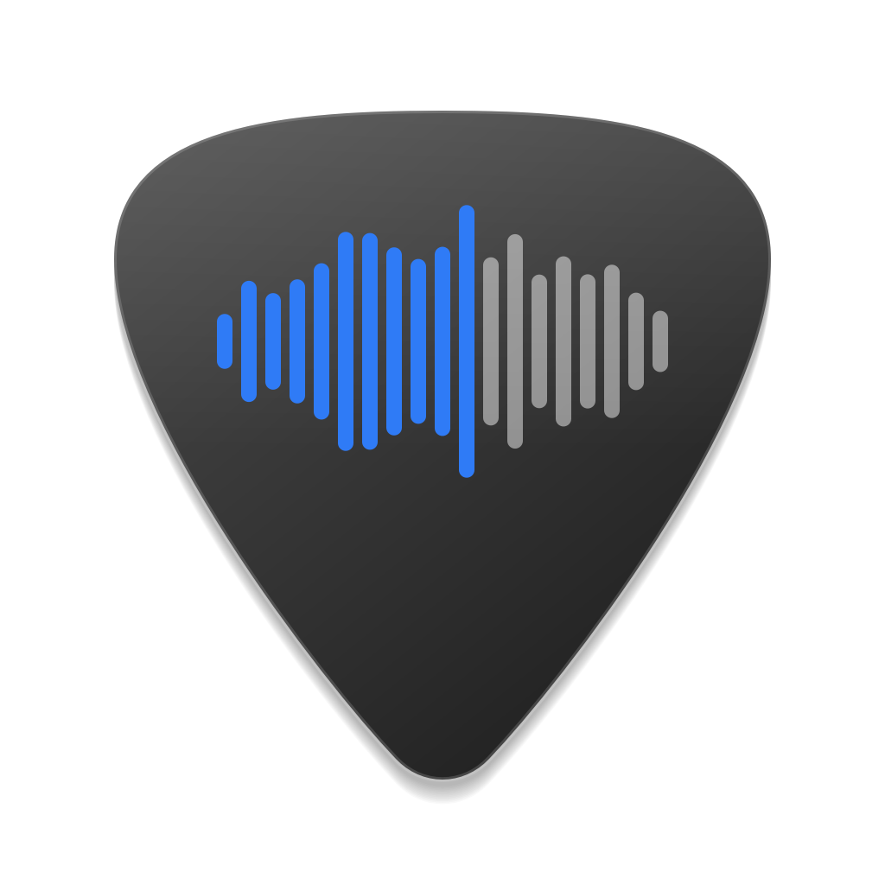

<p align="center"></p>

# Setlist

A minimal backing-track player for band practice. Point it at a folder of `.mp3` and `.wav` files and it shows them as a large, readable list with waveforms, so it's easy to see from across the room what's playing and where you are in the song.

## Features

- Big track titles with each track's length, and a waveform that fills in as the track plays
- Stops after each track and waits for you, or plays straight through (toggle)
- Loudness normalization (LUFS, ITU-R BS.1770), so the volume doesn't jump between tracks
- Keyboard-first controls
- Follows the system light/dark appearance

## Install

```sh
pip install setlist
```

Requires Python 3.10+.

## Usage

```sh
setlist                     # opens the last folder you used
setlist ~/Music/Gig-Set     # opens a specific folder
```

You can also run it as `python -m setlist`.

### macOS app

```sh
setlist --install-app            # creates ~/Applications/Setlist.app
setlist --install-app /Applications
```

This creates a regular app you can open from Launchpad or Spotlight and keep in the Dock. It runs Setlist with the Python environment you installed it into, so re-run the command if you move or recreate that environment.

### Keys

| Key | Action |
| --- | --- |
| Space | Play / pause the selected track |
| ↑ / ↓ | Select previous / next track |
| ← / → | Jump back / forward 5 seconds |
| Backspace | Back to the start of the track |
| Return | Play the selected track |
| ⌘O | Open a folder |

Click a track to select it, double-click to play it, and click the waveform of the loaded track to jump to that spot.

### Top bar

| Button | Action |
| --- | --- |
| ≡ | Choose the folder |
| ⇥ / ⇉ | Stop after each track / play continuously |
| ≃ | Loudness normalization (on by default) |

Normalization only turns louder tracks down to match the quietest one (never below −23 LUFS), so nothing is ever boosted into clipping. Your files are not modified.

## Development

```sh
python3 -m venv .venv
.venv/bin/pip install -e .
.venv/bin/setlist
```

The app icon is drawn in code; regenerate it with `.venv/bin/python tools/make_icon.py`.

## License

MIT, see [LICENSE](LICENSE).
